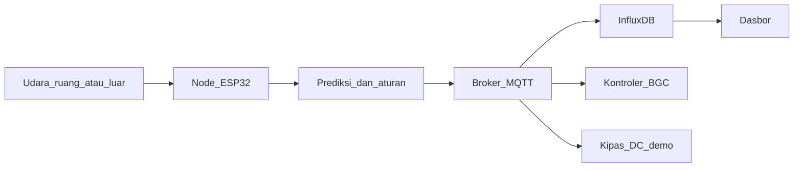

# Spesifikasi Fungsional SAVENT

| | |
|---|---|
| Produk | SAVENT (Smart Adaptive Ventilation) |
| Tim | Kantin Borju |
| Dokumen | FSD-SAVENT, versi 0.1 |
| Tanggal | 20 Oktober 2026 |
| Status | Draft untuk hackathon 21–23 Oktober 2026 dan prototipe tugas akhir |
| Pasangan | [HW-SENSING.md](HW-SENSING.md) |

SAVENT adalah sistem pemantau kualitas udara dalam dan luar ruang yang mengeluarkan satu rekomendasi ventilasi. Rekomendasi itu dihitung di perangkat. Pada tugas akhir, rekomendasi dikirim ke kontroler Bangunan Gedung Cerdas. Pada demo lomba, rekomendasi yang sama menyalakan kipas DC.

## 1. Tujuan

Pengelola gedung membutuhkan pembacaan CO₂, indeks VOC, tekanan, suhu, kelembapan, PM2.5, dan PM10 di dalam serta di luar ruang, karena tanpa pasangan data itu ventilasi tidak dapat mempertimbangkan udara yang akan masuk, dan penghuni menanggung akumulasi CO₂ serta partikel.

Sistem ini menutup celah tersebut dengan node sensing yang sama untuk kedua sisi, jalur data terbuka, dan prediksi CO₂ sepuluh menit di edge.

## 2. Koherensi tugas akhir dan lomba

Tugas akhir dan proposal lomba adalah satu produk dengan dua batas penyerahan.

| Artefak | Tugas akhir | Demo hackathon 3 hari |
|---|---|---|
| Node indoor tujuh besaran | Ya, ini prototipe yang dipercepat | Ya, dirakit dan diukur |
| Node outdoor, PCB yang sama | Spesifikasi lengkap di HW-SENSING; pasang setelah indoor stabil | Tidak difabrikasi |
| MQTT, buffer lokal, InfluxDB, dasbor status baku mutu | Ya | Versi tipis yang jalan di jaringan lokal |
| Prediksi CO₂ 10 menit di edge, dengan aturan sebagai cadangan | Ya, karena keputusan harus hidup saat WAN putus | Ya, dibandingkan dengan baseline |
| Pesan `vent_request` ke kontroler BGC | Antarmuka resmi | Dipublikasikan, penerima gedung boleh belum ada |
| Kipas DC | Bukan lingkup aktuasi gedung | Bukti loop tertutup |
| Kipas, damper, dan HVAC gedung | Tetap milik kontroler BGC pelaksana | Tidak disentuh |
| Xiaomi Smart Air Purifier | Tidak dibeli. Adaptor baca-saja hanya jika unit pelaksana sudah terpasang | Tidak dipakai |
| ASIC / tape-out | Tidak | Tidak. Lapis perangkat keras lomba adalah front-end sensing pada MCU |

Analitik di server menyimpan histori, laporan, dan data training. Inferensi yang mempengaruhi rekomendasi berjalan di node.

Tiga lapis yang ditunjukkan ke juri:

1. Digitalisasi: alur MQTT, penyimpanan berstempel waktu, dasbor, dan jejak perubahan mode serta `vent_request`.
2. Edge AI: prediksi CO₂ sepuluh menit di MCU, dengan aturan ambang sebagai cadangan yang terukur.
3. Semikonduktor: front-end sensing (domain daya, antarmuka sensor, kompensasi CO₂ terhadap tekanan). Rinciannya di HW-SENSING.

## 3. Pengguna

| Pengguna | Kebutuhan yang dilayani sistem |
|---|---|
| Pengelola gedung | Kondisi kini, histori, status terhadap ambang, peringatan, dan rekomendasi ventilasi |
| Penghuni | Status ruang yang dapat dibaca tanpa istilah sensor |
| SCCIC | Kesesuaian parameter dengan sistem kontrol cerdas ventilasi BGC |
| Pelaksana (Urbansolv) | Payload terbuka yang dapat dibaca backend yang sudah ada |
| Juri hackathon | Demo loop tertutup, metrik terhadap baseline, dan operasi saat Wi-Fi diputus |

Lokasi tugas akhir: Gedung 2 ITB Innovation Park, lantai 2, Summarecon, Bandung. Demo lomba boleh di ruangan mana pun; `site_id` membedakan lokasi.

## 4. Lingkup

Masuk lingkup:

- Pengukuran tujuh besaran di node indoor dan, dengan perangkat yang sama, di node outdoor.
- Koreksi CO₂ terhadap tekanan, bendera kualitas, dan penolakan pembacaan yang macet atau di luar jangkauan.
- Publikasi MQTT, penyangga saat koneksi putus, penyimpanan deret waktu, dasbor.
- Prediksi CO₂ sepuluh menit dan penerjemahannya menjadi `vent_request`.
- Empat mode operasi dan interlock pada mode otomatis terbatas.
- Kipas DC sebagai aktuator demo.

Di luar lingkup:

- Penggantian atau kendali damper, AHU, dan HVAC gedung.
- Pembelian atau modifikasi Xiaomi.
- Klaim konsentrasi TVOC dalam ppm atau ppb.
- Klaim kepatuhan hukum yang mengikat. Dasbor menampilkan status terhadap ambang acuan, bukan sertifikat.
- Enclosure outdoor pada jalur kritis tiga hari.
- SSR 220 V yang diberi tegangan jala-jala.

## 5. Acuan dan ambang tampilan

| Acuan | Pemakaian dalam sistem |
|---|---|
| Permen PUPR No. 10 Tahun 2023 | Daftar parameter kontrol cerdas ventilasi: CO₂, TVOC, tekanan, kelembapan, suhu. PM2.5 dan PM10 ditambahkan sesuai kebutuhan tugas akhir |
| Permenkes No. 2 Tahun 2023 | Ambang tampilan: CO₂ 1000 ppm; PM2.5 25 µg/m³ sebagai rata-rata 24 jam; suhu 23–26 °C; RH 40–60% |
| ANSI/ASHRAE 62.1 | Keputusan udara luar memakai perbandingan partikel indoor dan outdoor |
| IEC 60529 | Target selungkup outdoor IP54, dirinci di HW-SENSING |
| ISO/IEC 20922 | MQTT 3.1.1 |

Aturan tampilan yang mengikat firmware dan dasbor:

- CO₂ dibandingkan dengan 1000 ppm pada nilai terkoreksi tekanan, bukan nilai mentah.
- PM2.5 sesaat ditampilkan sebagai indikator dan diberi label bahwa ambang 25 µg/m³ adalah rata-rata 24 jam. Angka kepatuhan PM hanya diisi bila ada rata-rata 24 jam.
- Suhu dan RH dibandingkan dengan pita 23–26 °C dan 40–60%.
- Indeks VOC tidak dibandingkan dengan ambang ppm. Label di UI: indeks tidak terkalibrasi.
- Tekanan ditampilkan dalam hPa dan dipakai untuk koreksi CO₂. Tidak ada ambang "baik/buruk" untuk tekanan.

## 6. Konteks sistem



Satu keputusan, dua penerima. `vent_request` selalu dipublikasikan. Kipas DC hanya bergerak pada mode semi-otomatis setelah ada persetujuan, atau pada mode otomatis terbatas. Kontroler BGC adalah penerima tugas akhir dan boleh belum terhubung saat lomba.

## 7. Persyaratan fungsional

| ID | Persyaratan |
|---|---|
| FR-1 | Node mengukur CO₂, suhu, kelembapan, tekanan, resistansi gas, PM2.5, dan PM10 |
| FR-2 | CO₂ yang dipublikasikan adalah nilai setelah koreksi tekanan `C_corr = C_meas × 1013,25 / P_hPa` |
| FR-3 | Setiap besaran membawa bendera kualitas. Dasbor dan pengendali tidak memakai sampel bertanda `warming`, `stuck`, `fault`, atau `out_of_range` sebagai dasar keputusan |
| FR-4 | Partikel saat RH ≥ 75% tetap ditampilkan dan ditandai `rh_high`. Perbandingan udara luar mengabaikan sampel `rh_high` |
| FR-5 | Rekaman tergabung diterbitkan setiap 30 detik ke `savent/{site}/{node}/telemetry` |
| FR-6 | Saat broker tidak terjangkau, node menyimpan sekurang-kurangnya 4 jam rekaman dan mengirimnya kembali tanpa menggandakan `seq` |
| FR-7 | Node menghitung prediksi CO₂ 10 menit dari CO₂ terkoreksi, laju perubahannya, dan RH |
| FR-8 | Jika model tidak siap atau fitur tidak valid, keputusan memakai aturan ambang, selama CO₂ sendiri valid |
| FR-9 | Jika CO₂ tidak valid, `vent_request` tidak naik ke hidup dan kipas demo tidak dinyalakan oleh sistem |
| FR-10 | Mode default adalah dukungan keputusan: rekomendasi tampil, kipas demo tetap mati |
| FR-11 | Mode otomatis terbatas menyalakan kipas demo hanya setelah lolos interlock pada bagian 8 |
| FR-12 | Jika data outdoor valid tersedia dan PM2.5 luar lebih tinggi daripada PM2.5 dalam ditambah 10 µg/m³, `outdoor_intake_ok` bernilai false |
| FR-13 | Dasbor menunjukkan kondisi, bendera kualitas, status ambang, prediksi, mode, dan `vent_request` |
| FR-14 | Perubahan mode, perintah manual, dan setiap nyala/mati kipas tercatat dengan waktu dan sumber perintah |
| FR-15 | Sistem tidak menyimpan identitas penghuni, citra, atau suara |
| FR-16 | Adaptor Xiaomi, bila perangkat itu sudah ada, hanya membaca dan mengisi sumber `xiaomi`. Ketiadaan adaptor tidak menonaktifkan FR-1 sampai FR-15 |

## 8. Mode operasi dan interlock

| Mode | Kode | Perilaku kipas demo | Perilaku pesan |
|---|---|---|---|
| Pantau | 0 | Paksa mati | Prediksi dan ambang tetap dihitung untuk ditampilkan |
| Dukungan keputusan | 1 | Paksa mati | `vent_request` dipublikasikan. Ini mode tugas akhir |
| Semi-otomatis | 2 | Hidup hanya setelah perintah `confirm` yang masih berlaku 60 detik | Rekomendasi menunggu orang |
| Otomatis terbatas | 3 | Mengikuti keputusan setelah interlock | Untuk demo lomba |

Keputusan mentah, sebelum interlock:

- Model siap dan CO₂ valid: minta hidup bila prediksi 10 menit ≥ 1000 ppm atau CO₂ terkoreksi ≥ 1000 ppm. Minta mati bila prediksi < 900 ppm dan CO₂ terkoreksi ≤ 800 ppm. Di antara itu, pertahankan keadaan kipas.
- Model tidak siap dan CO₂ valid: minta hidup bila CO₂ terkoreksi ≥ 1000 ppm. Minta mati bila CO₂ terkoreksi ≤ 800 ppm.
- CO₂ tidak valid: jangan minta hidup.

Interlock mode 3, semuanya wajib:

- CO₂ berbendera `ok`.
- Waktu minimum hidup 180 detik, waktu minimum mati 120 detik.
- Perintah manual `force_off` dari dasbor mengalahkan model sampai dilepas.
- `outdoor_intake_ok = false` tidak mematikan kipas demo ruangan. Bendera itu hanya menolak rekomendasi memasukkan udara luar, karena kipas demo bukan damper gedung.

Nilai `vent_request` yang dipublikasikan: `off`, `recommend_on`, `on`. Pada mode 0 dan 1, kipas fisik tetap mati walaupun nilai pesan `recommend_on`.

## 9. Model data dan MQTT

Broker memakai MQTT 3.1.1. Topik:

| Topik | Arah | Isi |
|---|---|---|
| `savent/{site}/{node}/telemetry` | node ke broker | Rekaman 30 detik, QoS 1 |
| `savent/{site}/{node}/status` | node ke broker | Terhubung, mode, versi firmware, retained |
| `savent/{site}/{node}/event` | node ke broker | Perubahan mode, nyala/mati kipas, penolakan interlock |
| `savent/{site}/{node}/command` | dasbor ke node | Ubah mode, `confirm`, `force_off`, `force_off_release` |

`site` dan `node` huruf kecil, angka, dan tanda hubung. Contoh: `hackathon-demo` / `indoor-01`, `innovation-park-g2` / `outdoor-01`.

Contoh telemetry:

```json
{
  "ts": "2026-10-21T02:00:30Z",
  "time_source": "ntp",
  "seq": 1204,
  "node": "indoor-01",
  "site": "hackathon-demo",
  "co2_raw_ppm": 812,
  "co2_ppm": 885,
  "t_c": 27.4,
  "rh_pct": 62.0,
  "p_hpa": 932.1,
  "gas_ohm": 185000,
  "voc_index_uncalibrated": 140,
  "pm25_ugm3": 18,
  "pm10_ugm3": 24,
  "quality": {
    "co2": "ok",
    "climate": "ok",
    "gas": "ok",
    "pm": "ok"
  },
  "co2_pred_10min_ppm": 1040,
  "model_used": true,
  "vent_request": "recommend_on",
  "outdoor_intake_ok": true,
  "mode": 1,
  "fan_on": false
}
```

`ts` adalah UTC. Saat NTP belum pernah berhasil, `time_source` bernilai `unset` dan dasbor menandai waktu sebagai tidak tepercaya. Setelah NTP pernah berhasil lalu Wi-Fi putus, `time_source` bernilai `holdover`.

`seq` naik satu tiap rekaman yang berhasil dibentuk, termasuk yang hanya masuk buffer. Pengirim ulang memakai `seq` yang sama.

Perintah:

```json
{ "cmd": "set_mode", "mode": 3, "source": "dashboard" }
{ "cmd": "confirm", "source": "dashboard" }
{ "cmd": "force_off", "source": "dashboard" }
```

Node menolak perintah tanpa `source` dan mencatat penolakan di topik event.

Pemetaan penyimpanan: setiap lapangan numerik telemetry menjadi field InfluxDB pada measurement `telemetry`, tag `site` dan `node`. TimescaleDB tidak dibangun.

## 10. Kecerdasan tepi

Tugas model: memperkirakan CO₂ terkoreksi 10 menit ke depan supaya rekomendasi dapat terbit sebelum pembacaan melewati 1000 ppm.

Fitur, dihitung di node dari sampel yang bendera CO₂ dan iklimnya `ok`:

- `co2_ppm` terkini
- `dco2_dt` dalam ppm per menit, selisih CO₂ terkoreksi terhadap sampel sekitar 2 menit sebelumnya
- `rh_pct` terkini

Model hackathon adalah regresi linier:

`co2_10min = a0 + a1·co2_ppm + a2·dco2_dt + a3·rh_pct`

Koefisien dicocokkan di laptop pada jejak yang diputar ulang, lalu ditanam sebagai konstanta firmware. Tidak ada training di MCU dan tidak ada panggilan awan saat inferensi.

Baseline yang wajib dilaporkan berdampingan:

- Persistensi: prediksi sama dengan CO₂ sekarang.
- Aturan: hidup pada 1000 ppm, mati pada 800 ppm, tanpa prediksi.

Metrik pada jejak uji yang sama:

- MAE prediksi model terhadap CO₂ yang benar-benar terjadi 10 menit kemudian.
- MAE persistensi pada titik yang sama.
- Lead time: selisih waktu antara `recommend_on` dan saat CO₂ terukur mencapai 1000 ppm. Nilai positif berarti peringatan lebih dulu.

Model tidak dipakai pada sampel yang fiturnya tidak valid. FR-8 dan FR-9 mengatur perilaku itu. Indeks VOC dan PM tidak menjadi masukan model pada versi ini, karena yang dikendalikan adalah akumulasi CO₂.

## 11. Persyaratan nonfungsional

| ID | Batas |
|---|---|
| NF-1 | Rekaman diterbitkan setiap 30 detik saat sensor sudah `ok` |
| NF-2 | CO₂ tidak diberi bendera `ok` sebelum 3 menit sejak catu hidup |
| NF-3 | Buffer lokal minimal 4 jam pada periode 30 detik (480 rekaman). Target tugas akhir 24 jam |
| NF-4 | Pada mode 3, keputusan kipas tetap berjalan bila broker mati |
| NF-5 | Dasbor lokal menampilkan rekaman baru dalam 5 detik setelah sampai di broker, pada jaringan demo |
| NF-6 | Node demo dicatu 5 V untuk elektronika dan 12 V terpisah untuk kipas. Rel 220 V tidak dipakai |
| NF-7 | Satu node mewakili satu zona. MVP hackathon adalah satu zona indoor |

Ketersediaan 95% pada proposal adalah target pilot tugas akhir, bukan kriteria lulus hari ketiga.

## 12. Keamanan dan privasi

Yang diukur hanya besaran udara dan status perangkat.

Pada demo lomba, broker boleh berjalan di jaringan lokal tanpa TLS. Dokumen konfigurasi mencatat keterbatasan ini. Target tugas akhir adalah MQTT atas TLS pada port 8883 dengan akun per node. Perintah mode dan `force_off` hanya diterima dari klien yang memegang kredensial dasbor.

Jejak pada FR-14 menyimpan sumber perintah, bukan nama penghuni.

## 13. Verifikasi tiga hari

| Hari | Bukti yang harus ada |
|---|---|
| 1 | Node membaca tujuh besaran, CO₂ terkoreksi berbeda dari nilai mentah pada tekanan Bandung, MQTT terlihat di klien, dasbor status ambang |
| 2 | Kabel Wi-Fi atau broker dimatikan, `seq` tidak hilang setelah sambung kembali. Jejak yang sama menghasilkan MAE model dan MAE persistensi. Kipas DC mengikuti mode 3 dan diam pada mode 1 |
| 3 | Log interlock: CO₂ dipaksa tidak valid lalu kipas tidak menyala; `force_off` mengalahkan model. Pitch memakai angka hari kedua |

Uji koreksi yang dipakai di meja: pada tekanan sekitar 930 hPa, CO₂ terkoreksi lebih tinggi daripada nilai mentah sekitar 9%. Contoh target: 800 ppm mentah pada 930 hPa menjadi sekitar 872 ppm. Ini pemeriksaan arah rumus, bukan kalibrasi pabrik.

Uji macet: sensor CO₂ yang tidak menjawab atau nilai di luar 400–5000 ppm menghasilkan bendera bukan `ok` dan `fan_on = false` pada mode 3.

## 14. Ketertelusuran ke kebutuhan tugas akhir

| Kebutuhan tugas akhir | Dipenuhi oleh |
|---|---|
| N1, N2 pengukuran indoor dan outdoor | FR-1, satu rancangan node, dua pemasangan |
| N3 integrasi tanpa memodifikasi perangkat yang sudah ada | FR-16, tidak ada Xiaomi di BOM |
| N4 keandalan pembacaan | FR-2, FR-3, FR-4 |
| N5 ketahanan outdoor | HW-SENSING bagian selungkup; di luar jalur kritis lomba |
| N6 kontinuitas data | FR-6, NF-3, NF-4 |
| N7 penyimpanan deret waktu | Bagian 9 |
| N8 analitik | Bagian 10 di edge; histori di InfluxDB |
| N9 visibilitas | FR-13 |
| N10 keamanan | Bagian 12, dengan TLS sebagai target tugas akhir |

## 15. Pembagian saat hackathon

| Peran | Hasil yang menjadi bukti |
|---|---|
| Sirkuit sensor dan driver kipas | Node menyala, domain 5 V dan 12 V terpisah, kipas mengikuti GPIO |
| Tata letak, uji, kalibrasi | CO₂ mentah versus terkoreksi, prosedur baseline outdoor tercatat |
| Middleware, basis data, dasbor | Topik MQTT, InfluxDB atau penampil setara, status ambang, jejak event |
| Fusi, kompensasi, model | Koefisien regresi, tabel MAE terhadap persistensi, bendera kualitas |

Enclosure outdoor dan gambar SSR 220 V tidak menggeser urutan di atas.
