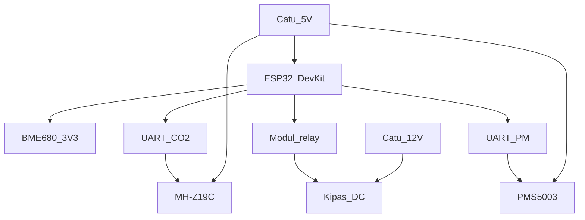

# Rancangan Hardware Sensing SAVENT

| | |
|---|---|
| Pasangan | [FSD-SAVENT.md](FSD-SAVENT.md) |
| Versi | 0.1, 20 Oktober 2026 |
| Rakitan besok | ESP32 DevKit, MH-Z19C, BME680, PMS5003, modul relay, kipas 12 V |
| Bukan BOM | Xiaomi Smart Air Purifier, SSR yang diberi 220 V, enclosure outdoor |

Dokumen ini menetapkan front-end sensing yang menjadi lapis perangkat keras hackathon dan prototipe tugas akhir. Satu papan melayani indoor dan outdoor. Firmware berbicara ke sensor melalui antarmuka tetap, sehingga MH-Z19C dapat diganti SCD41 tanpa mengubah MQTT.

## 1. Arsitektur

Tujuh besaran datang dari node ini sendiri.

| Besaran | Modul rakitan besok | Catatan yang mengikat UI |
|---|---|---|
| CO₂ | MH-Z19C, UART | 400–5000 ppm, akurasi khas ±(50 ppm + 5% pembacaan). Yang disiarkan adalah nilai setelah koreksi tekanan |
| Suhu, RH, tekanan | BME680, I2C | Tekanan juga masukan koreksi CO₂ |
| Indeks VOC | Resistansi gas BME680 | Indeks tidak terkalibrasi. Bukan ppm |
| PM2.5, PM10 | PMS5003, UART | Nilai lingkungan (`atmospheric`), bukan CF=1 |

Target tugas akhir bila modulnya didapat, dengan pin logika yang sama:

| Fungsi | Pengganti | Yang dilepas dari jalur aktif |
|---|---|---|
| CO₂, plus suhu dan RH bawaan | SCD41, I2C | MH-Z19C |
| Tekanan yang lebih senyap | BMP390, I2C | Tekanan BME680 |
| Indeks VOC Sensirion | SGP41, I2C | Pemakaian gas BME680 untuk indeks |

BME680 tetap boleh tinggal di papan sebagai cadangan iklim. Hanya satu sumber CO₂ yang aktif.

## 2. Penempatan sensor

Indoor, zona MVP:

- Tinggi 1,1–1,5 m dari lantai, di zona bernapas.
- Sekurang-kurangnya 1 m dari mulut supply AC, pintu yang sering terbuka, dan jendela yang terkena matahari langsung.
- Lubang difusi CO₂ dan saluran udara PMS5003 tidak menghadap dinding.
- Satu node untuk satu ruang pada prototipe ini.

Outdoor, dipasang setelah indoor stabil:

- Udara yang diwakili adalah udara yang akan masuk ke gedung, bukan udara di atas atap yang terkena knalpot setempat atau udara di dalam cerobong.
- BME680 berada di dalam pelindung radiasi berwarna terang dan berventilasi. Sensor iklim yang kena matahari langsung tidak dipakai untuk koreksi.
- Tekanan melihat atmosfer melalui ventilasi membran. Kotak kedap membuat tekanan palsu.
- Lubang PMS5003 terlindung dari percikan dan tidak menghadap ke atas.
- MH-Z19C tidak dikurung di kompartemen yang panas. Pemanas internalnya sudah cukup.

## 3. Bill of materials rakitan

| Qty | Komponen | Fungsi |
|---|---|---|
| 1 | ESP32 DevKit 30 atau 38 pin | MCU, Wi-Fi, inferensi, MQTT |
| 1 | MH-Z19C | CO₂ NDIR, catu 5 V, UART 3,3 V |
| 1 | Modul BME680 | I2C, catu 3,3 V |
| 1 | PMS5003 beserta kabel | PM, catu kipas sensor 5 V, data 3,3 V |
| 1 | Modul relay 1 kanal, pemicu kompatibel 3,3 V | Saklar kipas demo |
| 1 | Kipas DC 12 V, arus di bawah 300 mA | Aktuator demo |
| 1 | Adaptor 5 V, sekurang-kurangnya 2 A | Seluruh elektronika |
| 1 | Adaptor 12 V, sekurang-kurangnya 1 A | Hanya kipas |
| 1 | Sekring 1 A pada jalur 12 V | Proteksi kipas |
| — | Kabel, breadboard atau papan lubang, header | Rakitan hari pertama |

Jangan mencatu MH-Z19C atau PMS5003 dari pin 3,3 V ESP32.

## 4. Pin ESP32 DevKit

UART0 (GPIO1 TX, GPIO3 RX) tetap untuk USB dan log. Sensor tidak digantung di situ.

| Fungsi | GPIO | Arah terhadap ESP32 | Level |
|---|---|---|---|
| I2C SDA | 21 | dua arah | 3,3 V |
| I2C SCL | 22 | keluaran clock | 3,3 V |
| CO₂ RX sensor, yaitu TX ESP32 | 17 | keluaran | 3,3 V |
| CO₂ TX sensor, yaitu RX ESP32 | 16 | masukan | 3,3 V |
| PM RX sensor, yaitu TX ESP32 | 26 | keluaran | 3,3 V |
| PM TX sensor, yaitu RX ESP32 | 25 | masukan | 3,3 V |
| Pemicu relay | 27 | keluaran | 3,3 V |
| LED status | 2 | keluaran | 3,3 V |

Alamat I2C BME680 adalah 0x76 bila SDO ke ground, 0x77 bila SDO ke 3,3 V. Modul bawaan biasanya sudah memasang pull-up. Tidak menambah pull-up kedua.

Konstanta firmware `FAN_ACTIVE_LEVEL` disetel di meja. Banyak modul relay menyala saat GPIO rendah. Default dokumen ini: aktif rendah, sampai uji kontinuitas membuktikan sebaliknya.

PMS5003 pin SET dibiarkan tidak terhubung agar sensor berjalan. Pin RST tidak diikat ke 5 V.

## 5. Domain daya

Tiga domain, ground bertemu di satu titik di dekat konektor catu 5 V:

| Domain | Sumber | Beban |
|---|---|---|
| 5 V | Adaptor 5 V 2 A | DevKit (pin 5 V), MH-Z19C, PMS5003 |
| 3,3 V | Regulator di DevKit | BME680 dan GPIO |
| 12 V | Adaptor 12 V | Kumparan tidak. Hanya kipas, lewat kontak relay |

Perkiraan arus 5 V: ESP32 saat Wi-Fi memancar dapat menukik ratusan miliampere, MH-Z19C di bawah 100 mA, PMS5003 di bawah 100 mA. Adaptor 1 A terlalu tipis untuk puncak Wi-Fi ditambah kedua sensor. Pakai 2 A.

Pada PCB nanti, 3,3 V boleh dari LDO 3,3 V dengan kapasitor masukan dan keluaran, selama drop dan panasnya dihitung untuk puncak Wi-Fi. Pada rakitan besok, pakai regulator milik DevKit. Jangan memberi 5 V ke pin 3,3 V.

Dioda flyback tidak diperlukan pada kontak relay yang menyambung kipas DC bila modul relay sudah memutus fasa kipas secara mekanis. Tetap pasang dioda terbalik di klem kipas bila yang dipakai adalah MOSFET low-side, katoda ke 12 V, anoda ke drain.

Ground adaptor 12 V dan ground ESP32 harus terhubung, kalau tidak, referensi kumparan relay mengambang terhadap GPIO.

## 6. Protokol sensor

### 6.1 MH-Z19C

- Baud 9600, 8N1.
- Catu 5,0 V ± 0,1 V pada pin Vin. RX dan TX tetap 3,3 V.
- Perintah baca: `FF 01 86 00 00 00 00 00 79`.
- Jawaban 9 byte diawali `FF 86`. Konsentrasi mentah = byte 2 × 256 + byte 3.
- Checksum jawaban: `0xFF − (jumlah byte 1 sampai 7) + 1`, dibandingkan dengan byte 8. Tiga kegagalan beruntun membuat bendera `fault`.
- Kalibrasi otomatis pabrik dimatikan dengan `FF 01 79 00 00 00 00 00 86`. Ruang kampus yang terus berpenghuni tidak kembali ke 400 ppm, sehingga kalibrasi otomatis akan menggeser nol ke nilai yang salah.
- Nol manual (`87`) hanya di udara luar yang dianggap 400 ppm, setelah pemanasan, dan tidak dilakukan di dalam kelas.
- Baca tidak lebih cepat dari sekali per detik. Rekaman sistem tetap 30 detik.
- Bendera `warming` selama 3 menit pertama sejak 5 V hadir, walaupun datasheet menyebut pemanasan sekitar 1 menit. Selama `warming`, CO₂ tidak masuk model dan tidak menyalakan kipas.

### 6.2 BME680

- Catu 3,3 V. Mode forced untuk suhu, tekanan, dan kelembapan.
- Gas heater dinyalakan bila pustaka yang dipakai mendukungnya. Resistansi gas berbendera `warming` sampai 5 menit.
- `voc_index_uncalibrated` = skala 0–500 terhadap resistansi baseline `R0` yang disimpan setelah gas pertama kali `ok` pada lokasi itu: makin kecil resistansi terhadap `R0`, makin tinggi indeks. Indeks ini hanya untuk tampilan. Pengendali ventilasi tidak membacanya.
- Tekanan dalam hPa wajib ada pada rekaman yang sama dengan CO₂ yang dikoreksi.

### 6.3 PMS5003

- Catu 5 V pada VCC. TX modul ke GPIO 25. Frame 32 byte diawali `42 4D`.
- Pakai PM2.5 dan PM10 lingkungan (byte atmosfer, bukan blok CF=1): PM2.5 pada byte 12–13, PM10 pada byte 14–15, keduanya big-endian.
- Frame gagal checksum tiga kali berturut-turut menghasilkan `fault`.
- Bendera `warming` 30 detik pertama.
- RH dari BME680 ≥ 75% mengubah bendera PM menjadi `rh_high` tanpa menghapus angka.

## 7. Kompensasi CO₂

MH-Z19C sudah mengompensasi suhu di dalam modul. Yang ditambahkan firmware adalah tekanan, karena Bandung berada jauh di bawah 1013,25 hPa dan NDIR yang tidak dikoreksi akan membaca terlalu rendah.

`C_corr = C_meas × 1013,25 / P_hPa`

`P_hPa` adalah tekanan BME680 pada waktu baca CO₂ yang sama. Bila tekanan berbendera `fault`, CO₂ ikut berbendera `fault` dan tidak dikoreksi dengan tekanan usangan.

Pemeriksaan arah di meja: 800 ppm pada 930 hPa menjadi sekitar 872 ppm. Bila implementasi menghasilkan angka yang lebih kecil dari nilai mentah pada tekanan di bawah 1013 hPa, rumusnya terbalik.

Suhu dan RH tetap disimpan pada rekaman yang sama untuk audit dan untuk fitur model. Keduanya tidak mengubah rumus tekanan pada versi ini.

Batas layak CO₂ setelah koreksi: 400–5000 ppm. Di luar itu, `out_of_range`.

## 8. Bendera kualitas

| Bendera | Arti | Boleh masuk keputusan CO₂ |
|---|---|---|
| `warming` | Masih dalam waktu buang awal | Tidak |
| `ok` | Checksum benar dan dalam jangkauan | Ya |
| `rh_high` | Hanya untuk PM, RH ≥ 75% | PM tidak dipakai untuk `outdoor_intake_ok` |
| `stuck` | Tidak ada jawaban UART, atau CO₂ mentah identik selama 15 menit dan bernilai 0, 400, atau 5000 | Tidak |
| `out_of_range` | Di luar jangkauan modul | Tidak |
| `fault` | Checksum gagal berulang, atau tekanan hilang saat koreksi | Tidak |

CO₂ yang datar di ruang kosong pada nilai selain 0, 400, dan 5000 tidak serta-merta `stuck`. Sensor ini beresolusi 1 ppm dan ruangan bisa stabil.

## 9. Aktuator

Rakitan lomba: modul relay memutus jalur 12 V ke kipas DC. GPIO 27 sesuai `FAN_ACTIVE_LEVEL`. Mode 0 dan 1 menahan GPIO pada keadaan mati walaupun `vent_request` bernilai `recommend_on`.

Gambar antarmuka HVAC kemudian, tidak dipasang dan tidak diberi tegangan pada hackathon: SSR di sisi 220 V dengan sekring dan pemutus sendiri, masukan SSR dari GPIO melalui transistor, netral tidak diputus sebagai satu-satunya pengaman. Sampai ada pendamping lab, jalur ini tetap gambar.

`outdoor_intake_ok` dihitung bila ada node `outdoor` dengan PM `ok`. Itu sinyal untuk kontroler BGC, bukan perintah ke kipas demo.

## 10. PCB dua lapis, setelah breadboard stabil

- FR4 1,6 mm, dua lapis. Ground pour di lapisan bawah.
- DevKit atau modul ESP32 di tepi papan. Tidak ada tembaga di bawah antena.
- Sensor di tepi yang berlawanan dengan regulator dan relay, dengan lubang udara yang tidak terhalang komponen.
- Jejak sinyal 0,3 mm, jejak 5 V ke PMS5003 dan MH-Z19C sekurang-kurangnya 0,8 mm.
- Header atau JST untuk ketiga sensor supaya modul yang drift dapat diganti tanpa membuang papan.
- Titik uji: 5 V, 3,3 V, GND, SDA, SCL, TX/RX CO₂, TX/RX PM, GPIO kipas.
- Lubang M3 di empat sudut.
- Relay dan jalur 12 V dijauhkan dari BME680 supaya panas kumparan tidak menjadi suhu ruangan.

Rakitan hackathon tidak menunggu PCB ini.

## 11. Selungkup outdoor

Target IP54 menurut IEC 60529: debu terbatas dan percikan air dari segala arah. Bukan rendaman.

- Dinding luar terang, berlubang angin untuk iklim, dengan pelindung radiasi berlapis.
- Membran ventilasi pada jalur tekanan.
- Saluran PM menjorok ke samping atau ke bawah, dengan penutup percikan.
- Kabel masuk lewat kelenjar. Adaptor tetap di dalam gedung. Node outdoor tidak membawa baterai pada versi ini.
- Lubang kondensat di titik terendah, terhalang serangga.
- CO₂ tidak ditempatkan di kantong udara di atas sumber panas.

Sampai selungkup ini ada, jangan menaruh MH-Z19C atau BME680 di luar ruangan terbuka. Spesifikasi ini cukup untuk fabrikasi setelah lomba; ia bukan tugas hari pertama.

## 12. Kalibrasi dan uji meja

1. Catat versi modul dan foto wiring domain 5 V, 3,3 V, dan 12 V sebelum daya dihidupkan.
2. Hidupkan 5 V saja. Pastikan 3,3 V ada, relay tidak klik, dan tidak ada komponen yang panas dalam satu menit.
3. Setelah 3 menit, baca CO₂ mentah, tekanan, dan CO₂ terkoreksi. Tolak firmware yang mengoreksi ke arah yang salah pada tekanan Bandung.
4. Matikan kalibrasi otomatis MH-Z19C dan baca kembali statusnya.
5. Baseline 400 ppm hanya di luar ruangan, pagi, setelah pemanasan, bila hendak menyetel nol. Catat jam dan tekanan saat itu.
6. Bandingkan PM dengan indra kasar saja pada hackathon: asap dekat versus udara bersih harus menaikkan PM2.5. Angka absolut PM menunggu instrumen referensi tugas akhir.
7. Hidupkan 12 V. Mode 1: kipas diam sambil telemetry menunjukkan `recommend_on` bila CO₂ didorong tinggi (hembusan napas). Mode 3: kipas menyala, dan mati bila UART CO₂ dicabut.
8. `force_off` mematikan kipas dalam satu siklus telemetry meskipun napas masih membuat prediksi tinggi.

Hasil langkah 3, 7, dan 8 disimpan sebagai bukti pitch.

## 13. Adaptor Xiaomi

Tidak dibeli dan tidak diperlukan.

Bila di Innovation Park sudah ada unit yang dibaca gateway pelaksana, adaptor terpisah memetakan PM2.5, PM10, suhu, dan RH ke skema telemetry dengan `"source": "xiaomi"`. Node SAVENT tetap sumber ketujuh besaran, termasuk CO₂, tekanan, dan gas yang tidak dimiliki purifier. Adaptor yang gagal tidak mengubah bendera node.

## 14. Risiko yang diterima

| Risiko | Batas yang ditulis di pitch |
|---|---|
| MH-Z19C murah dan bergeser dalam hitungan bulan | Akurasi modul ±(50 ppm + 5%), bukan kelas instrumen. Nol tidak dipercaya dari kalibrasi otomatis |
| BME680 gas bukan TVOC hukum | Indeks tidak terkalibrasi, tidak masuk pengendali |
| PMS5003 bias pada RH tinggi | Bendera `rh_high` dari 75% |
| Tekanan BME680 cukup untuk koreksi 9% di Bandung, belum untuk metrologi | Rumus dan contoh 800 ppm / 930 hPa menjadi bukti arah, bukan sertifikat |
| Demo tanpa TLS | Dicatat sebagai batas lomba. Target tugas akhir MQTTS |
| Kipas demo bukan ventilasi gedung | Mode 1 adalah penyerahan tugas akhir. Mode 3 hanya bukti loop |
